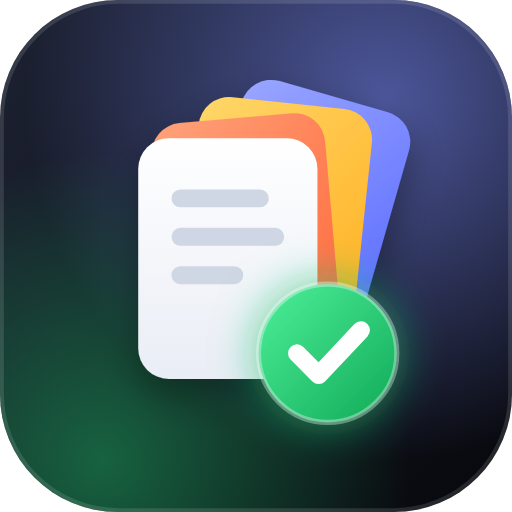
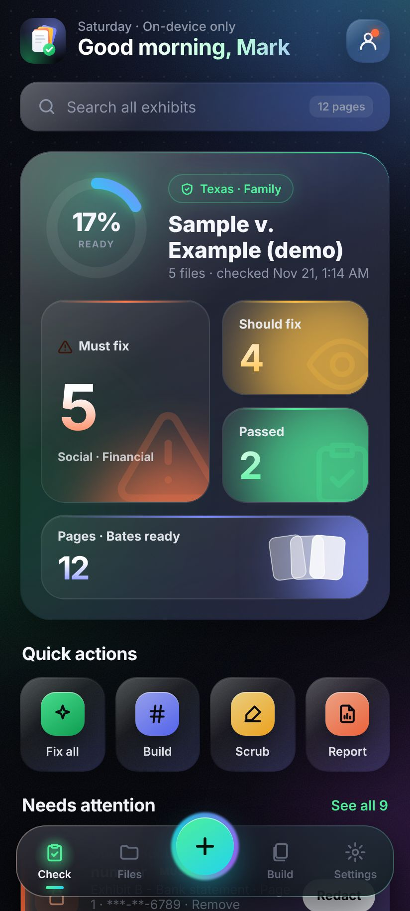
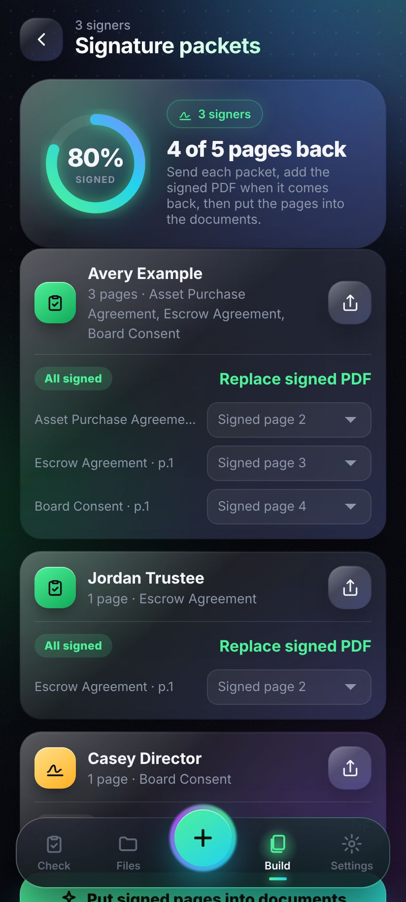
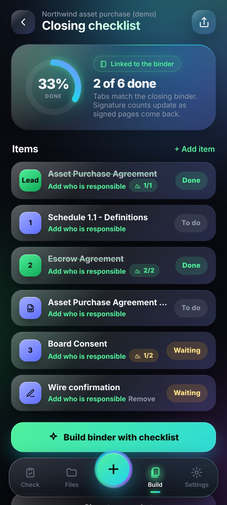

<h1 align="center">FileReady</h1>

<b>Court-ready filings. Clean deal documents. Checked on your device.</b>

<a href="https://quuxin2-a11y.github.io/fileready/site.html">Website</a> · <a href="https://quuxin2-a11y.github.io/fileready/">Web app</a> · <a href="https://quuxin2-a11y.github.io/fileready/guide.html">Interactive guide</a> · <a href="https://github.com/quuxin2-a11y/fileready/releases/download/latest/fileready.apk">Android APK</a>

  

**Android:** install `fileready.apk` from Releases (Android 8 or newer). **iPhone:** open the web app in Safari → **Share** → **Add to Home Screen**.

FileReady checks PDFs before they are filed or sent, fixes what it can, and builds the final package. Everything runs on the device: no account, no uploads.

## What it does
- **Finds problems:** text still readable under black boxes, Social Security and account numbers, birth dates, minors' names, blank and sideways pages, wrong page sizes, scans that are not searchable, hidden author names and comments, file size limits, missing fonts.
- **Fixes them:** true redaction, remove blank pages, turn pages upright, scrub hidden data, split to size, with undo for every change.
- **Builds the filing:** exhibit cover sheets and labels, index with Bates ranges, Bates numbering, bookmarks.
- **Deal work:** contract checks (placeholders, amounts that do not match their words, missing schedules, broken cross-references, blank signer names, mixed currencies, ambiguous dates), closing binders and signature packets.
- **Closing tools:** signed pages put back into the final documents, and a closing checklist linked to the binder tabs.
- **Word, scans and versions:** Word (.docx) checks and cleanup, text recognition for scanned pages, compare two versions with a redline PDF.
- **Firm settings:** export one settings file and share it so the whole firm uses the same rules.
- **License codes:** firms pay directly; a signed code entered in Settings → License shows the firm and seats. Codes are made with the "Make license code" GitHub workflow.
- **Research (Beta):** review the other side's filing (or yours) for common mistakes with options and rule citations, and find similar court cases. Patent check is a Labs tool, off by default (Settings → Labs); it needs a free USPTO Open Data Portal key.
- **Rules:** all 50 states and D.C., federal courts, the USPTO, and data-protection flags for eight regions, each linked to its official source.

## Security
Files stay on the device: no server, no account, no upload. See [SECURITY.md](SECURITY.md), [requirements](SECURITY_REQUIREMENTS.md), [threat model](THREAT_MODEL.md), [architecture](SECURITY_ARCHITECTURE.md) and [checklist](SECURITY_CHECKLIST.md). Report problems privately through the Security tab.

## Files
`index.html` app · `boot.js` security policy and start-up · `app.js` screens · `engine.js` PDF checks and fixes · `rules.js` rule packs · `research.js` research tools · `keys.js` research keys (filled at build) · `app.css` design · `site.html` website · `guide.html` guide · `.github/workflows/apk.yml` Android build.

FileReady flags common problems. It is not legal advice.

© 2026 Mark Joseph. All rights reserved. See LICENSE.
