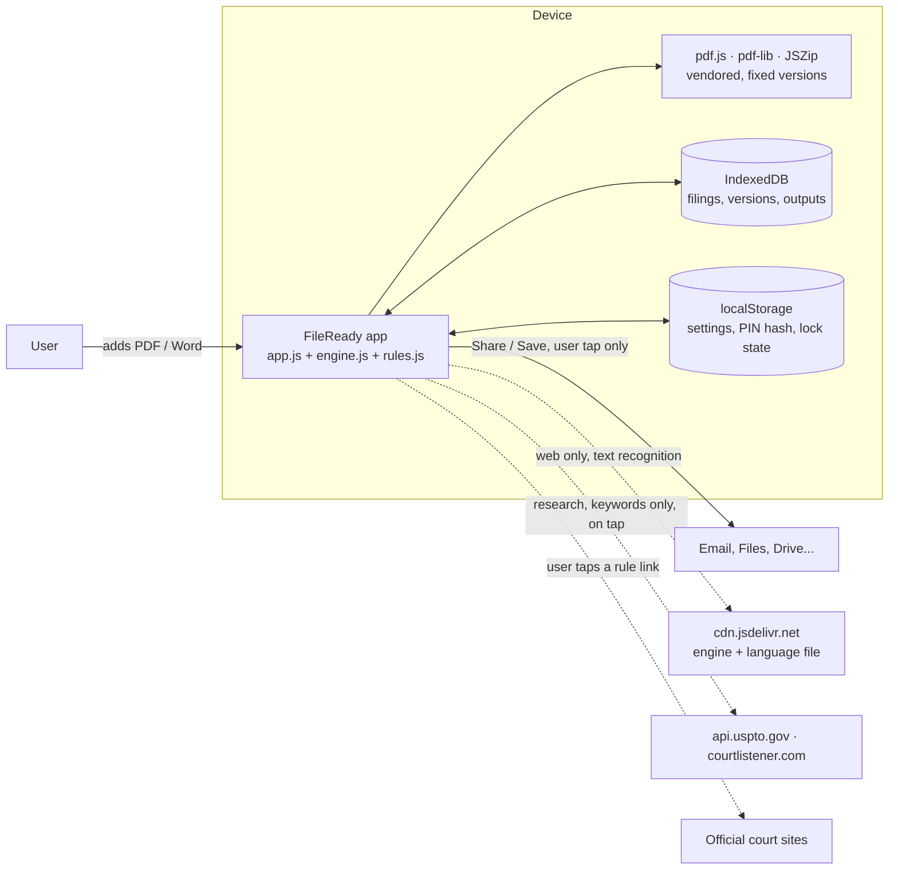

# FileReady security architecture

## 1. Overview
FileReady is a single-page app that runs entirely on the device. The same code runs as:
- the **web version** on GitHub Pages (HTTPS), and
- the **iPhone app**, installed from Safari with **Add to Home Screen** (same web code, runs full screen and offline), and
- the **Android app**, which wraps the same files in a native shell (Capacitor 6) built by GitHub Actions.

There is no FileReady server, database or account. The only network use is optional: the text-recognition engine in the web version, and links the user chooses to open.



## 2. Components
| Component | Role | Security notes |
|---|---|---|
| `index.html`, `boot.js` | Starts the app | `boot.js` adds the Content Security Policy (web) and registers the service worker. No inline scripts. |
| `pdfjs-init.mjs` + pdf.js 6.2.108 | Reads PDFs, page images, text | Script evaluation off; worker runs from the app's own origin. |
| pdf-lib 1.17.1 | Writes PDFs (fixes, builds, packets, signed pages) | Runs in the page; no network. |
| JSZip 3.10.1 | Reads and writes Word (.docx) files | Word files handled as XML; macros never run. |
| `engine.js` | Checks, redaction, scrub, build, compare, signed pages, checklist | Pure functions on bytes; no network. |
| `research.js` | Patent check, case search, filing review | Text analysis on the device; network calls only on tap, to api.uspto.gov and www.courtlistener.com, through the Android native HTTP layer or the browser. |
| `keys.js` | Built-in research keys | Empty in the repository; filled from GitHub Secrets by the APK and website builds. |
| `rules.js` | State, federal, USPTO and regional rule packs | Static data with links to official sources. |
| `app.js` | Screens, storage, lock | Escapes all document text before display; PIN and lock logic. |
| `sw.js` | Offline cache | Caches only same-origin GET requests. |
| Tesseract.js 5.1.1 | Text recognition for scans | Android: bundled in the APK. Web: loaded from cdn.jsdelivr.net when first used. Pages are processed on the device. |
| Capacitor 6 plugins | Share, save, haptics, browser, in-app browser, app | Outside links open in an in-app viewer, not the system browser. |
| (continued) | | Android only. |

## 3. Data storage
| Data | Where | Protection |
|---|---|---|
| Original files, versions, outputs | IndexedDB (`blobs`, `filings`) | App sandbox (Android) or browser profile (web); phone's file encryption. Not separately encrypted yet. |
| Analysis cache | IndexedDB (`an`) | Same as above. Rebuilt when needed. |
| Settings | localStorage `fr.settings` | No documents. Includes the redaction list. |
| PIN | localStorage `fr.settings.pin` | `p3$rounds$salt$hash`: PBKDF2-SHA256, 60,000 rounds, random 16-byte salt. Older formats are upgraded on the next unlock. |
| Lock state | localStorage `fr.lock` | Count of wrong tries and wait time. |
| Business plan | Inside `guide.html` | AES-256-GCM; key from PBKDF2-SHA256 (310,000 rounds); password never stored in the repo. Session copy of the password in `sessionStorage` only while the tab is open. |

## 4. Key flows
**Check and fix.** File bytes → pdf.js (text + page images) → pattern and rule checks → issue list. A fix writes a new version with pdf-lib; the original stays. Redaction renders the page to an image, burns in black boxes, then adds back only the text outside the boxes as an invisible layer.

**Build.** Current versions → cover sheets, labels, index, checklist page, Bates numbers, bookmarks → optional scrub → output saved in IndexedDB → user shares or saves.

**Signature packets and signed pages.** Signature pages found by text → one packet per signer, each page with a small FileReady footer → signed PDF added later → matched by footer text or page order → user checks matches → signed pages placed into a new version of each document (counterparts kept).

**Lock.** App opens → if a PIN is set, lock screen → PBKDF2 check (PIN only, no fingerprint) → tries counted → unlocked. After 2 minutes hidden, the app locks again.

## 5. Web hardening
Content Security Policy (added by `boot.js` for the web version):
```
default-src 'self'; script-src 'self' https://cdn.jsdelivr.net 'wasm-unsafe-eval';
worker-src 'self' blob:; connect-src 'self' https://cdn.jsdelivr.net https://www.courtlistener.com https://api.uspto.gov blob: data:;
img-src 'self' data: blob:; style-src 'self' 'unsafe-inline'; font-src 'self' data:;
media-src 'none'; object-src 'none'; frame-src 'none'; base-uri 'none'; form-action 'none'
```
- `'unsafe-inline'` is allowed for styles only (the screens use inline style attributes). Scripts never run inline.
- The guide and website use their own CSP with no outside connections.
- `no-referrer` on every page.

## 6. iPhone (home screen web app)
- Same Content Security Policy, PIN lock and on-device processing as the web version.
- Data is kept in Safari's storage for the home screen app, separate from the Safari browser. FileReady asks for persistent storage so iOS does not clear it.
- Removing the app from the home screen deletes its data.
- Files leave only through the iOS share sheet (including Save to Files).

## 7. Android hardening
- Loads only bundled files from the app package; no remote pages.
- `android:allowBackup="false"` set during the build, so app data is not copied to cloud or device-to-device backups.
- Android blocks cleartext (http) traffic by default.
- Release builds signed with the FileReady release key (see below).
- Not yet: CSP inside the app, optional screenshot blocking, app-level encryption of stored files.

## 8. Build pipeline
GitHub Actions (`.github/workflows/apk.yml`) checks out the repo, installs Node 20 and Java 17, installs Capacitor 6 and plugins and Tesseract.js 5.1.1 from npm, downloads the English language file from cdn.jsdelivr.net, builds the APK and publishes it to the `latest` release. The workflow has `contents: write` only, to publish the release and save the encrypted signing key once.

**Release signing**
1. The owner adds one GitHub secret, `SIGNING_PASSWORD` (random, 30+ characters, also saved in a password manager).
2. First build: the workflow creates an RSA 4096 key (valid about 27 years), encrypts it with AES-256-CBC and PBKDF2-SHA256 (600,000 rounds), and commits only the encrypted file `signing/release.jks.enc`.
3. Every build: the key is decrypted into the runner's temporary folder, the APK is aligned and signed with `apksigner`, then the key file is deleted.
4. The release notes show the certificate's SHA-256 fingerprint, and `fileready.apk.sha256` holds the APK checksum.
5. The version number is the build number, so each update installs over the previous one.
6. Without the secret, the workflow makes a clearly labeled test (debug) build.

If the password is lost, a new key must be made and every user must uninstall once. If it leaks, change it: make a new key and publish the new fingerprint.

**Website build.** A second workflow (`pages.yml`) publishes the website through GitHub Pages and writes `keys.js` from the `COURTLISTENER_TOKEN` and `USPTO_API_KEY` secrets. The APK build does the same.

Planned: exact versions with a lockfile, actions pinned by commit, and checksums for downloaded files.
